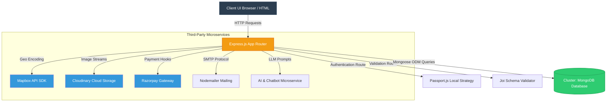
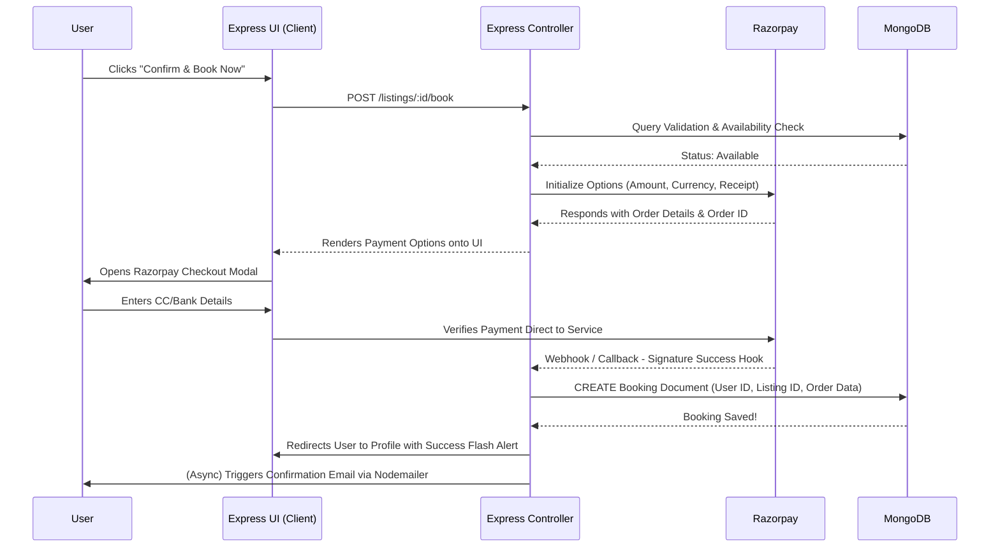

<div align="center">
  

  # 🌍 Wanderlust - The Ultimate Travel Booking Platform

  **A modern, feature-rich, highly scalable web application for discovering, reviewing, and booking your absolute dream vacation destinations.**

  []()
  []()
  []()
  []()
  []()
  []()
  []()
  []()
  []()
</div>

---

## 📑 Table of Contents
  - [📖 Project Overview](#-project-overview)
  - [✨ Comprehensive Feature Breakdown](#sparkles-comprehensive-feature-breakdown)
    - [🏨 Core Listing & Property Management](#-core-listing--property-management)
    - [📍 Interactive Maps & Geolocation](#-interactive-maps--geolocation)
    - [💳 Complete Booking & Payment Architecture](#-complete-booking--payment-architecture)
    - [👥 User Engagement & Profiles](#-user-engagement--profiles)
    - [🤖 Smart Functionalities](#-smart-functionalities)
    - [🛡️ Administration & Security Panel](#️-administration--security-panel)
    - [🔒 Backend Safety & Integrity Protocols](#-backend-safety--integrity-protocols)
  - [📸 Application Screenshots](#camera_flash-application-screenshots)
  - [🎨 Architecture & System Flow](#art-architecture--system-flow)
  - [🚀 Exhaustive Tech Stack](#rocket-exhaustive-tech-stack)
  - [⚙️ Comprehensive Installation & Setup Guide](#gear-comprehensive-installation--setup-guide)
    - [📋 Prerequisites](#-prerequisites)
    - [🔑 Procuring Third-Party API Keys](#-step-1-procuring-third-party-api-keys)
    - [💻 Clone the Repository](#-step-2-clone-the-repository)
    - [📦 Install Dependencies](#-step-3-install-dependencies)
    - [⚙️ Environment Variables (.env)](#️-step-4-environment-variables-env)
    - [🗄️ Database Initialization](#️-step-5-database-initialization-optional)
    - [🚀 Start the Server](#-step-6-start-the-server)
    - [🛠️ Common Troubleshooting](#️-common-troubleshooting)

---

## 📖 Project Overview

**Wanderlust** is a fully functional web-based marketplace closely mirroring the functionality of platforms like Airbnb. The core premise is simple: empower property owners to easily list their locations and enable travelers around the world to find and book unique accommodations seamlessly. 

However, Wanderlust pushes beyond the basics. It integrates advanced features ranging from **Mapbox Geo-Coding** to find properties interactively, to an **AI Chatbot** aiding user experience, a **Secure Razorpay Payment Gateway**, and a fully-fledged **Admin Management Dashboard**. It is designed with the user completely in mind—delivering modern aesthetics, snappy pagination, advanced search metrics, and robust security protocols.

---

## :sparkles: Comprehensive Feature Breakdown

Wanderlust has evolved significantly over time. Below is every single feature packed into the platform, making it a robust, production-ready system.

### 🏨 Core Listing & Property Management
*   **Dynamic Listings Directory**: A highly responsive, visual grid showcasing thousands of different properties around the world.
*   **Intuitive Creation Flow**: Seamless forms for authentic users to create, detail, and list their properties with price, descriptions, and uploaded images.
*   **Cloudinary Image Hosting**: Fully integrated image upload system using Multer & Cloudinary. Images are instantly uploaded, optimized, and served to users worldwide seamlessly.
*   **Listing Pagination**: Efficient server-side pagination ensuring blazing fast load speeds even with massive databases of properties. No endless lagging scrolls.
*   **Advanced Filtering**: A dynamic, interactive filter bar allowing users to narrow down options by property type (e.g., Villas, Castles, Camping, Beachfront, Pools).
*   **Wishlist System**: Let users click a "Heart" and save their favorite dream destinations to a personal wishlist for later review.

### 📍 Interactive Maps & Geolocation
*   **Mapbox SDK Integration**: Complete integration of Mapbox SDK to provide interactive mapping functionalities.
*   **Automatic Geocoding**: When a user inputs an address or city during listing creation, the backend automatically converts it to Longitude/Latitude coordinates.
*   **Interactive Property Maps**: Every listing details page includes a custom map pin to clearly show travelers exactly where they will be staying.

### 💳 Complete Booking & Payment Architecture
*   **Integrated Booking Engine**: Users can select dates, review total costs (calculating nights + price), and click "Book Now".
*   **Real-time Availability Status**: Check functionality to ensure properties aren't double-booked.
*   **Razorpay Gateway**: Integration of Razorpay ensuring smooth, seamless, and mathematically secure payment checkout sessions. Includes dynamic modals directly on the platform.
*   **Confirmation Tracking**: Successful orders create immediate Booking objects in the database associated with both the property owner and the traveling user.

### 👥 User Engagement & Profiles
*   **User Dashboard / Profiles**: Dedicated personal dashboard pages mapping out a user's *Active Listings* alongside their *Booking History*.
*   **Granular Review System**: A fully relational review system for properties. Users can submit 1 to 5-star ratings alongside written comments.
*   **Strict Review Validation**: Backend logic preventing span, blocking duplicate reviews, and explicitly stopping property owners from artificially rating their own listings.
*   **Automated Email Activities**: Hooked to *Nodemailer* functionalities. Sends confirmation emails for registrations, bookings, and alerts.

### 🤖 Smart Functionalities
*   **AI Feature Implementations**: Integrated AI algorithms.
*   **Interactive Chatbot**: An embedded smart assistant acting as customer service. Assisting users with navigation, answering FAQ queries regarding how to book, and managing profile settings.

### 🛡️ Administration & Security Panel
*   **Master Admin Dashboard**: A specialized protected `/admin` route explicitly accessible only to users with an 'admin' role privileges.
*   **Platform Statistics**: Visually summarizes platform health—total user counts, total live listings, total executed bookings, and transaction numbers.
*   **Moderation Controls**: Complete ability for the admin to DELETE abusive listings, remove fake users, or cancel flagged bookings.
*   **Admin Toggling**: Super-admin features allowing the promotion or demotion of other user accounts to Admin status.

### 🔒 Backend Safety & Integrity Protocols
*   **Passport.js Authentication**: Strong local authentication schemas protecting user data, including protected routing checking standard users vs logged out users.
*   **Dotenv Data Guarding**: Explicit decoupling of environment variables preventing Git exposure.
*   **Comprehensive Error Handling**: Dynamic Express error handling middleware wrapping all asynchronous calls ensuring the app never crashes.
*   **Schema Validations**: Usage of `Joi` API validation on every POST/PUT request ensuring corrupted or malicious payloads never reach the MongoDB instance.

---

## :camera_flash: Application Screenshots

Below is an exhaustive visual tour of every single page and major functionality of the Wanderlust platform.

*(Note: Replace the placeholder image URLs below with your project's actual HD screenshots)*

### 1. The Home / Explore Page
Displays all properties, the advanced filter bar, and the slick navigation headers.
<div align="center">
  
</div>

### 2. Single Listing Details View
Shows the property image, price, description, owner details, and the interactive map.
<div align="center">
  
</div>

### 3. Review & Ratings Section
The bottom section of a listing displaying user reviews, stars, and review forms.
<div align="center">
  
</div>

### 4. Create New Property Form
The intuitive interface forms for users to upload their properties to the marketplace.
<div align="center">
  
</div>

### 5. Secure Razorpay Checkout Gateway
The dynamic modal appearing over the page allowing credit card / UPI interactions.
<div align="center">
  
</div>

### 6. User Authentication Profiles (Login/Register)
The secure entry points for the application.
<p align="center">
  
  &nbsp;
  
</p>

### 7. AI Chatbot View
The interactive smart-assistance chatbot pop-over answering travel questions.
<div align="center">
  
</div>

### 8. The Wishlist Page
A specialized dashboard where users can see all their saved/hearted listings.
<div align="center">
  
</div>

### 9. User Profile Dashboard
Shows "My Listings" and "My Upcoming Bookings".
<div align="center">
  
</div>

### 10. Powerful Admin Dashboard
The moderation panel showing statistics tables and user/listing deletion toggles.
<div align="center">
  
</div>

---

## :art: Architecture & System Flow

### Complete System Overview Diagram


### Complex Booking & Payment Sequence Flow


---

## :rocket: Exhaustive Tech Stack

### Backend Technologies
*   **[Node.js](https://nodejs.org/en/)**: JavaScript runtime environment.
*   **[Express.js](https://expressjs.com/) (v5.1.0)**: Robust web application framework.
*   **[MongoDB](https://www.mongodb.com/)**: NoSQL database for flexible data schemas.
*   **[Mongoose](https://mongoosejs.com/) (v8.16.2)**: Elegant MongoDB object modeling for node.js.
*   **[Passport.js](http://www.passportjs.org/)**: Authentication middleware for Node.js.
*   **Passport-Local-Mongoose**: Mongoose plugin that simplifies building username and password login with Passport.
*   **[Joi](https://joi.dev/)**: Powerful schema description language and data validator for JavaScript.

### Frontend Technologies
*   **[EJS (Embedded JavaScript templating)](https://ejs.co/)**: Simple templating language that lets you generate HTML markup with plain JavaScript.
*   **EJS-Mate**: EJS layout engine for rendering complex layout boilerplates.
*   **Bootstrap 5**: Popular CSS Framework for responsive design and UI components.
*   **Vanilla JS**: DOM manipulation for alerts, pagination logic, and chatbot.

### Powerful Integrations
*   **[Cloudinary](https://cloudinary.com/)**: End-to-end image and video management solution. 
*   **Multer + Multer-Storage-Cloudinary**: Node.js middleware for handling `multipart/form-data` during file uploads.
*   **[Mapbox](https://www.mapbox.com/)**: Location data platform for custom global maps and geocoding.
*   **[Razorpay](https://razorpay.com/)**: Frictionless payment collection solution integrations.
*   **[Nodemailer](https://nodemailer.com/about/)**: Module to allow easy as cake email sending.

---

## :gear: Comprehensive Installation & Setup Guide

Get Wanderlust up and running on your local machine. This section provides an exhaustive step-by-step guide from zero to a fully functional locally-hosted server.

### 📋 Prerequisites

Before you begin, ensure you have the following installed on your local machine:
*   **[Node.js](https://nodejs.org/en/download/) (v14 or higher)** - Required to run the application backend.
*   **[npm](https://www.npmjs.com/) or [yarn](https://yarnpkg.com/)** - Node package managers to install dependencies.
*   **[Git](https://git-scm.com/downloads)** - For version control and cloning the repository.
*   **MongoDB Instance** - You can install [MongoDB Community Server](https://www.mongodb.com/try/download/community) locally or use a free cloud instance via [MongoDB Atlas](https://www.mongodb.com/cloud/atlas/register).

### 🔑 Step 1: Procuring Third-Party API Keys

Wanderlust relies on powerful external services. You will need to create free accounts and grab API keys for the following:

1.  **Mapbox (For Geolocation & Maps)**
    *   Sign up at [Mapbox.com](https://www.mapbox.com/).
    *   Navigate to your Account Dashboard and create a new **Public Access Token**.
2.  **Cloudinary (For Image Uploads)**
    *   Sign up at [Cloudinary.com](https://cloudinary.com/).
    *   Navigate to your Dashboard. You will need your `Cloud Name`, `API Key`, and `API Secret`.
3.  **Razorpay (For Payment Gateway)**
    *   Sign up for a test account at [Razorpay.com](https://razorpay.com/).
    *   Go to **Settings > API Keys** and generate a new pair of Test Keys (`Key ID` and `Key Secret`).
4.  **Gmail / SMTP Sender (For Nodemailer Email Notifications)**
    *   If using Gmail, enable **2-Step Verification** on your Google Account.
    *   Search for **App Passwords** in your Google Account security settings and generate a 16-character app password.

### 💻 Step 2: Clone the Repository

Open your terminal or command prompt and run the following command to download the source code:

```bash
git clone https://github.com/Sanket1516/Wanderlust.git
# Navigation into the project
cd Wanderlust-master
```

### 📦 Step 3: Install Dependencies

Once inside the root folder, run npm install. This will read the `package.json` file and install all necessary backend libraries (Express, Mongoose, Passport, etc.).

```bash
npm install
```

### ⚙️ Step 4: Environment Variables (.env)

The application requires strict environment variables to map to your API keys securely. 

1. Create a root file exactly named `.env`.
2. Add the following boilerplate and fill it in with the keys you generated in Step 1.

```env
# ==== DATABASE ====
# If local: mongodb://127.0.0.1:27017/wanderlust
# If Atlas: mongodb+srv://<user>:<password>@cluster0.net/wanderlust
MONGO_URI=your_mongodb_connection_string

# ==== CLOUDINARY (Images) ====
CLOUD_NAME=your_cloudinary_cloud_name
CLOUD_API_KEY=your_cloudinary_api_key
CLOUD_API_SECRET=your_cloudinary_api_secret

# ==== MAPBOX (Interactive Maps) ====
MAP_TOKEN=your_mapbox_public_token

# ==== RAZORPAY (Checkout System) ====
RAZORPAY_KEY_ID=your_razorpay_test_key_id
RAZORPAY_KEY_SECRET=your_razorpay_test_key_secret

# ==== NODEMAILER (Email Functionality) ====
EMAIL_USER=your_email_address@gmail.com
EMAIL_PASS=your_16_char_google_app_password

# ==== SECURITY ====
# A long, highly random string to hash your session cookies
SECRET=your_super_secret_session_string_here
```
> **Warning**: Never commit your `.env` file! It is already included in `.gitignore` by default.

### 🗄️ Step 5: Database Initialization (Optional)

If your database is entirely empty and you want to populate it with dummy listings (properties) to test the UI, check if there is an `init/` or `seed/` directory in the repository. Provide sample data if available.

```bash
node init/index.js 
# (Run this only if a seed script exists in your repo)
```

### 🚀 Step 6: Start the Server

You are fully configured! Launch the server by executing:

```bash
node app.js
```
*(Alternatively, use `npx nodemon app.js` during active development to auto-restart on saves).*

### 🎉 Step 7: Explore the Application

Open your favorite web browser and navigate to:
**[http://localhost:8080](http://localhost:8080)** 
*(Note: If your `app.js` runs on a different port like 3000, use that instead).*

Register your first account, explore listings, make a dummy booking, and interact with the AI Chatbot!

---

### 🛠️ Common Troubleshooting

*   **MongoServerSelectionError**: Your `MONGO_URI` is incorrect, or your IP address isn't whitelisted on your MongoDB Atlas Network Access pane.
*   **Mapbox Not Rendering**: Check your browser console. If there's a 401 Unauthorized error, your `MAP_TOKEN` is invalid.
*   **Failed Image Uploads**: Cloudinary credentials might be mismatched. Ensure `CLOUD_NAME`, `KEY`, and `SECRET` precisely match your Cloudinary dashboard.
*   **Razorpay Error**: Make sure you are using **TEST** keys and not LIVE keys during local development.

---

<div align="center">
    <h3>Built entirely from scratch with exceptional ambition.</h3>
    <p>Maintained by <strong>Sanket Mali</strong></p>
    <br/>
    <p>If you encounter any issues finding the perfect accommodation, or need to escalate an admin review, feel free to dive into the codebase or request feature updates!</p>
</div>
