<div align="center">

# Wanderlust

**An Airbnb-style accommodation marketplace built as a Node.js/Express MVC monolith with server-rendered EJS views.**


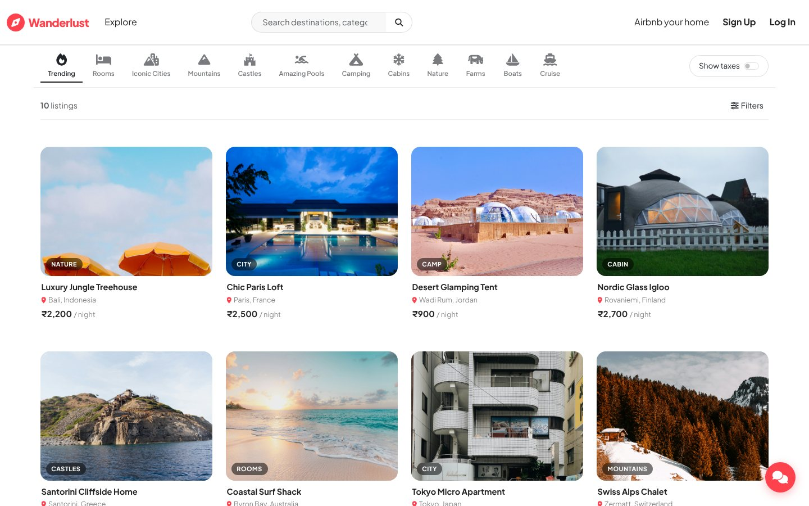

</div>

## Screenshots

> Real captures of the running app with the seed listings from `init/data.js` and demo users.

### Browse and book

| Listing details | Search ("cabin") |
|:---:|:---:|
| 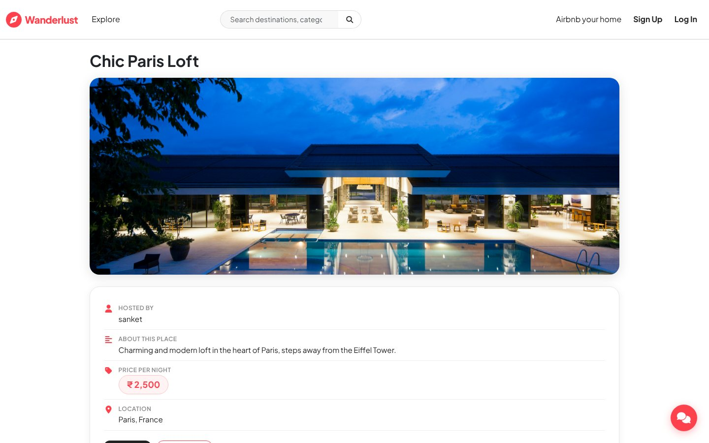 | 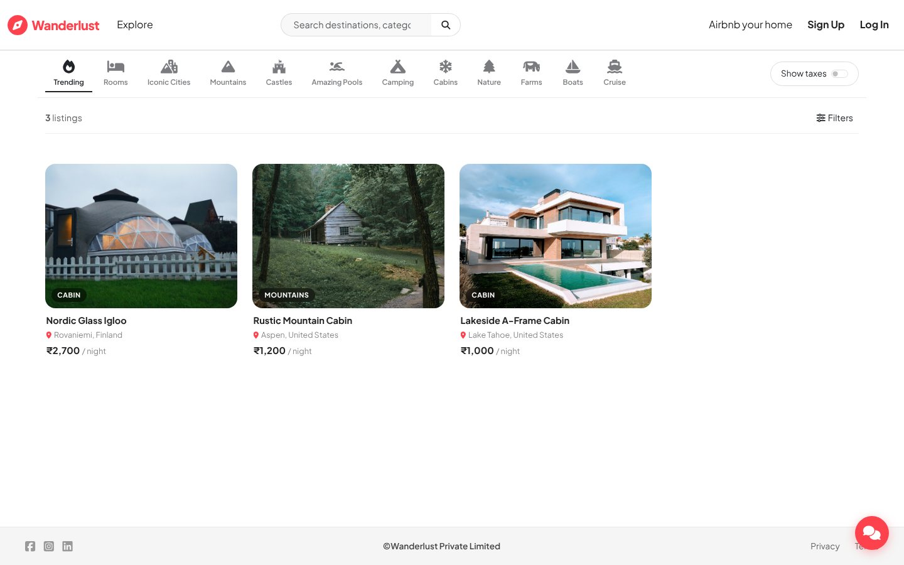 |
| **My bookings** | **Wishlist** |
| 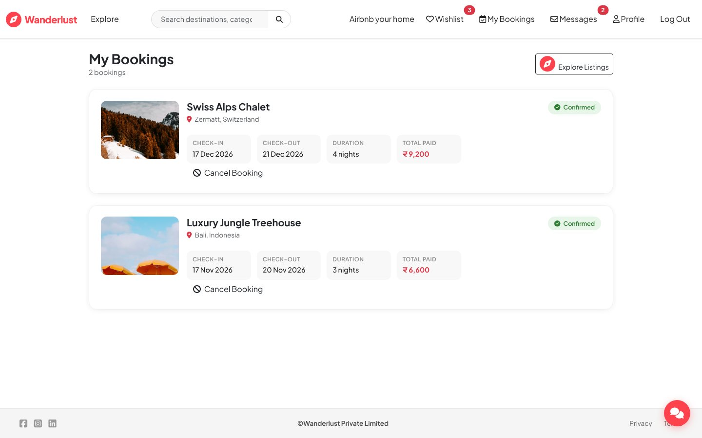 | 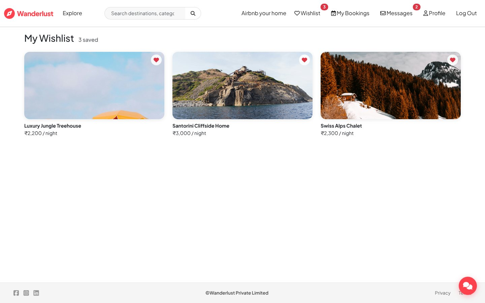 |
| **Messages inbox** | **Host–guest conversation** |
| 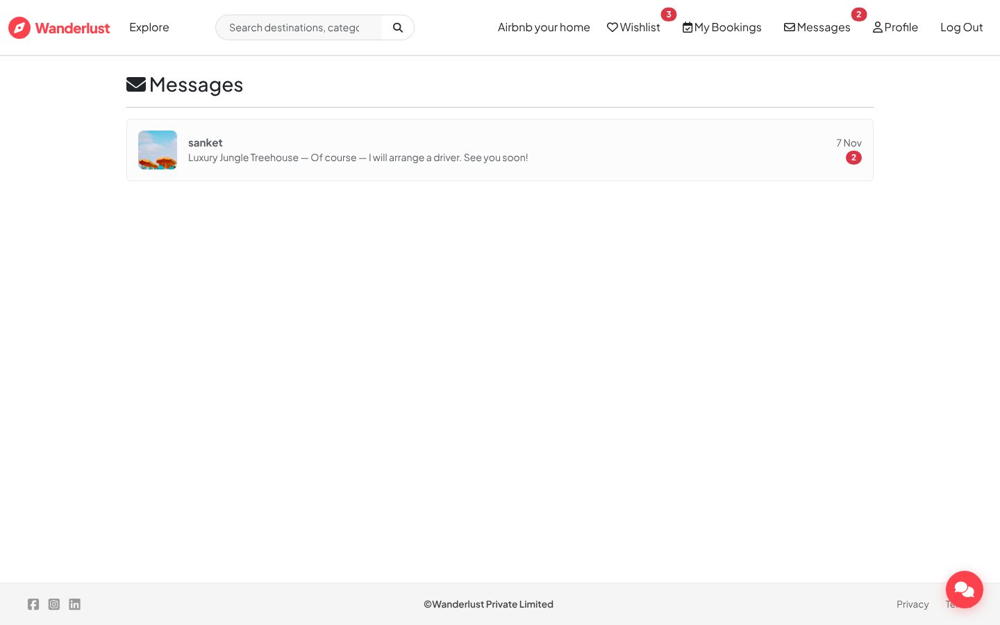 | 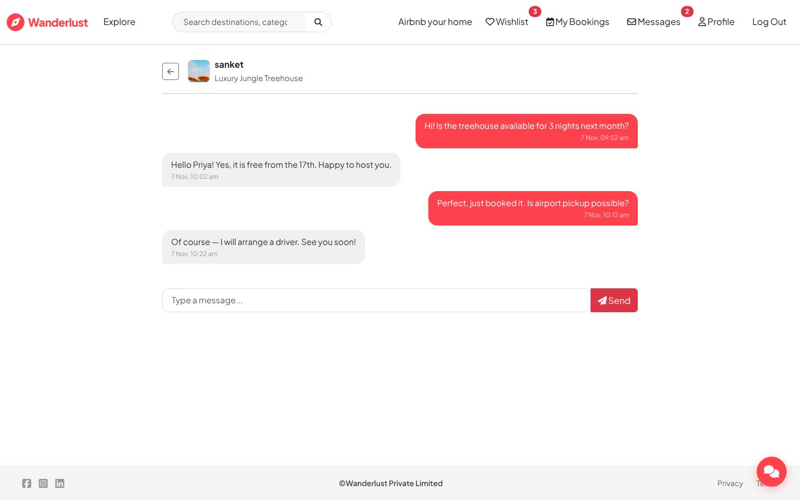 |
| **Profile** | **Host a place (with AI description)** |
| 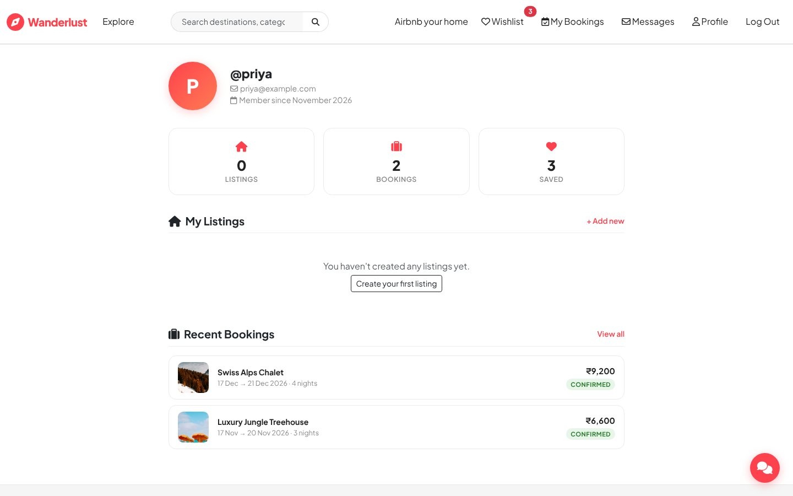 | 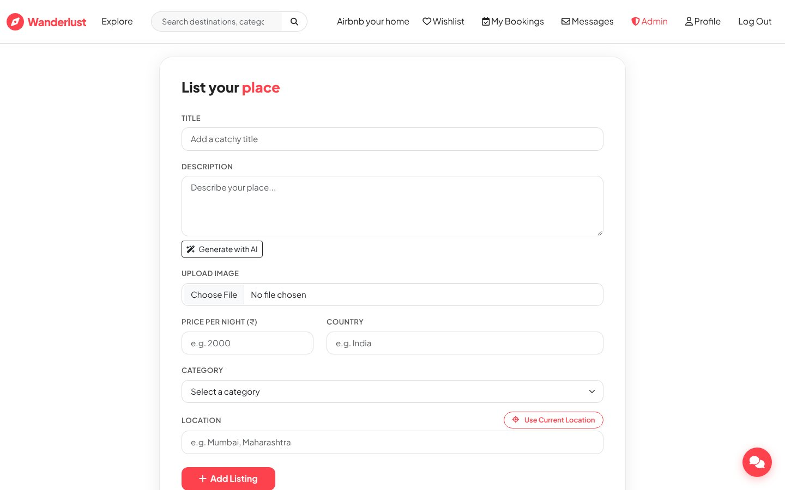 |

### Admin panel

| Dashboard | Listings moderation |
|:---:|:---:|
| 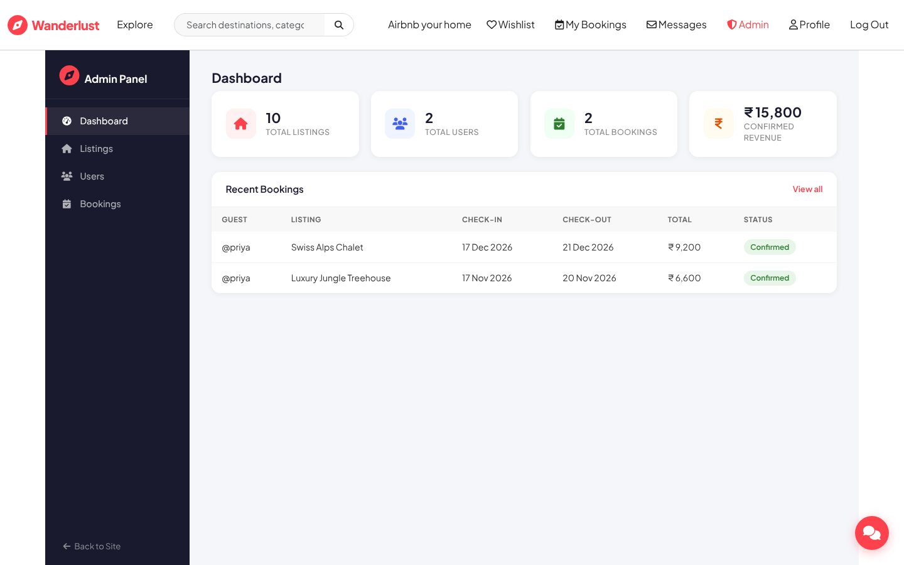 | 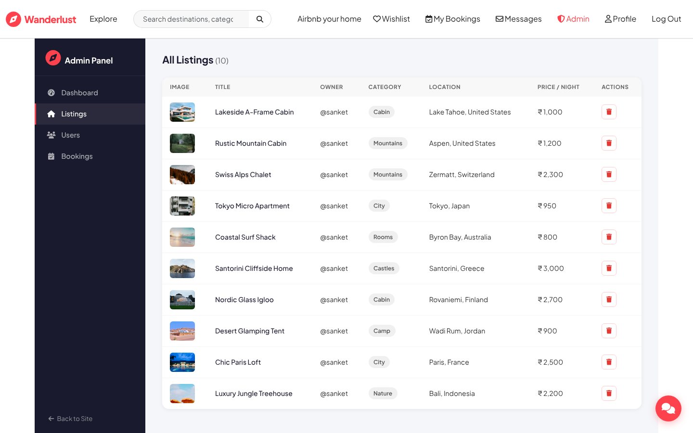 |
| **Users** | **Bookings** |
| 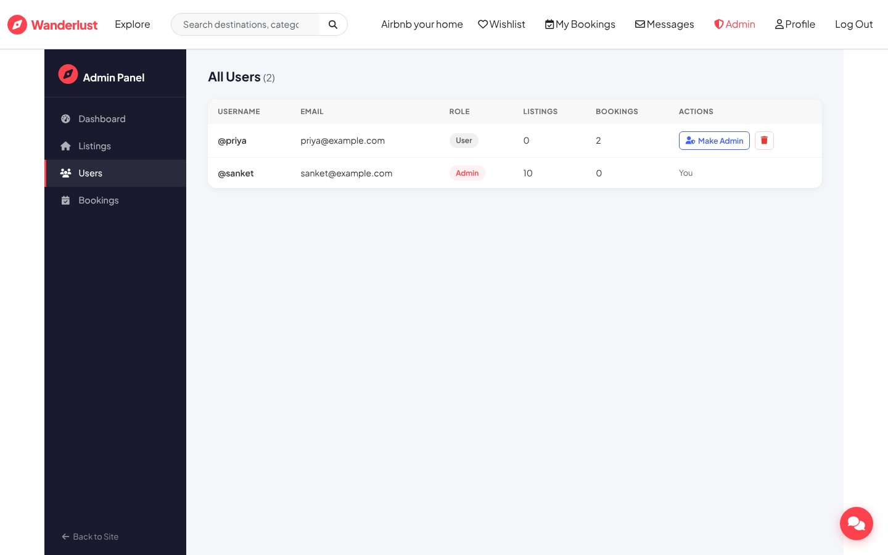 | 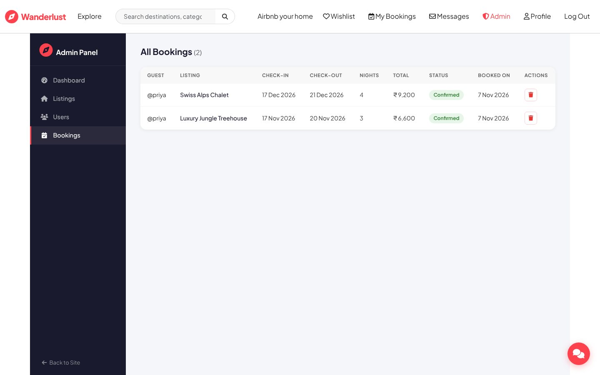 |

<details>
<summary>More: full listing page (reviews, AI review summary, map), sign-up and mobile</summary>

<p align="center">
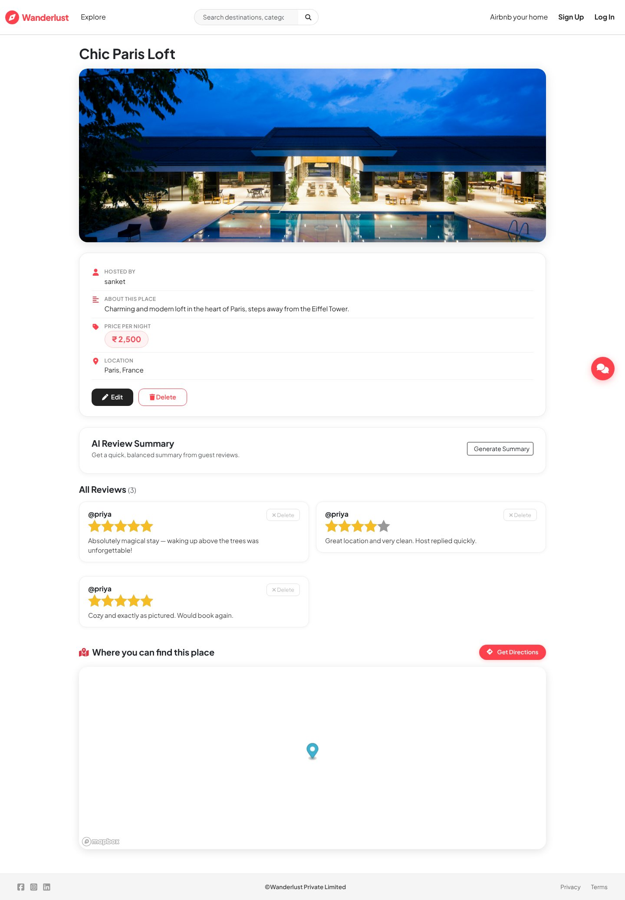<br/>
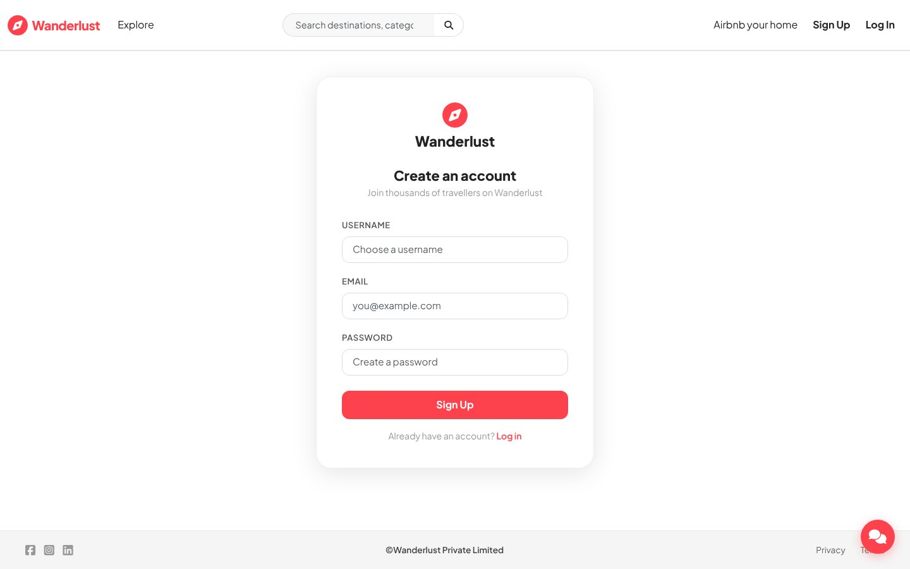<br/>
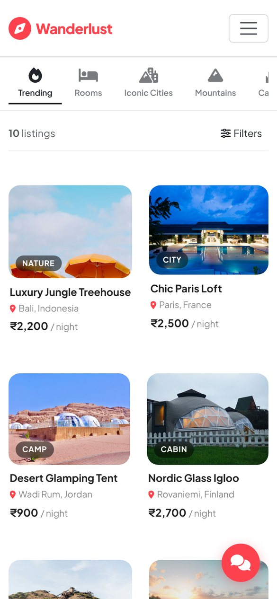
</p>

</details>

## Features

- **Listings:** create, edit and delete with Cloudinary image upload; search, filters (price, country, category), sorting and server-side pagination; map coordinates via Mapbox geocoding.
- **Guests:** wishlist, bookings with date validation and cancellation, reviews (duplicate and self-review prevention), host–guest messaging with unread counts.
- **Payments:** Razorpay order creation and payment verification.
- **Admin:** dashboard for analytics and moderation of users, listings and bookings.
- **AI:** generated listing descriptions, review summaries and a listing-aware travel chatbot (Cohere, Groq).
- **Email:** signup, booking, cancellation and message notifications (Nodemailer / Gmail).
- **Auth:** session-based login with Passport Local; Joi validation on inputs.

## Tech stack

Node.js · Express · MongoDB (Atlas) + Mongoose · EJS · Passport · Joi · Multer · Cloudinary · Mapbox · Razorpay · Nodemailer · Cohere · Groq

## Project structure

```
app.js            application entry point
routes/           Express routers
controller/       route logic
models/           Mongoose schemas
middleware.js     auth, validation and other shared middleware
schema.js         Joi validation schemas
views/, layouts/  EJS templates
public/           static CSS and JS
utils/            helpers and service wrappers
init/             seed data
docs/             detailed documentation
```

## Getting started

Requires Node.js and a MongoDB database (Atlas or local).

```bash
git clone https://github.com/Sanket1516/Wanderlust-master.git
cd Wanderlust-master
npm install
cp .env.example .env     # fill in the values below
npm start                # http://localhost:8080
```

Environment variables (see [`.env.example`](.env.example)): `ATLASDB_URL`, `PORT`, `NODE_ENV`, `SESSION_SECRET`, `CLOUD_NAME`, `CLOUD_API_KEY`, `CLOUD_API_SECRET`, `MAPBOX_TOKEN`, `RAZORPAY_KEY_ID`, `RAZORPAY_KEY_SECRET`, `GMAIL_USER`, `GMAIL_APP_PASSWORD`, `COHERE_API_KEY`, `COHERE_MODEL`, `GROQ_API_KEY`, `GROQ_MODEL`. Never commit your real `.env`.

## Documentation

- [Full technical documentation](docs/FULL_DOCUMENTATION.md): schemas, route map, security, integrations, payment/messaging/review flows, design decisions, HLD and use-case diagrams.
- [Razorpay payment gateway notes](docs/RAZORPAY_PAYMENT_GATEWAY.md)

## Known limitations and next steps

No automated tests, Docker setup, payment webhooks or refund automation yet; messaging is not real-time. Planned: tests, Razorpay webhooks, Socket.IO messaging, rate limiting and CI/CD.

## Author

Sanket Mali · [GitHub](https://github.com/Sanket1516)

## License

ISC, see [LICENSE](LICENSE) (matches `package.json`).
